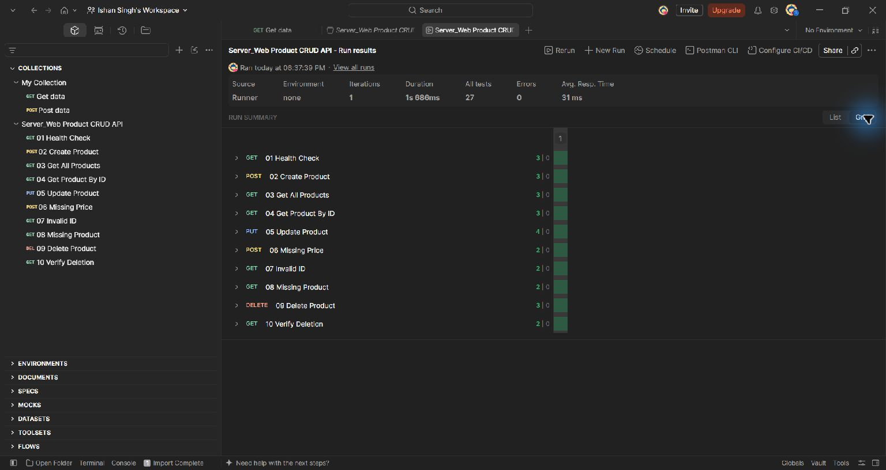

# Server_Web

A product CRUD REST API for the Web Programming backend assignment, built with
Node.js, Express 5, Mongoose, and MongoDB Atlas.

Repository: https://github.com/ishan18190-collab/Server_Web

Requirements reference: [Web Programming Backend Tutorial](https://github.com/agarwalpranav0711/web-programming-backend-tutorial).
This project implements that tutorial's endpoints and product schema. Its screenshots
and claims about completed Atlas/Postman verification are not copied.

## Quick start (Windows PowerShell)

Requires Node.js 22.13 or newer and Git.

```powershell
Set-Location 'D:\sem 3\web dev\server'
npm install
Copy-Item .env.example .env
```

If PowerShell blocks npm.ps1, use `npm.cmd` in place of `npm`.

Edit `.env` with your own Atlas connection string, then run:

```powershell
npm run dev
```

Use `npm start` without automatic reload. Default address:
http://localhost:5000/api/health. The server binds to your computer's loopback
interface and connects to MongoDB before accepting HTTP requests.

### Try it before creating Atlas

```powershell
npm run dev:local
```

This runs the same API against a temporary, real local MongoDB process. It downloads
a MongoDB binary on first use. No Atlas credentials are needed; all demo data is
removed when the process stops. Press Ctrl+C to stop. This mode does not replace
the assignment's Atlas verification.

## MongoDB Atlas setup

1. Create/sign into your MongoDB Atlas account and create a project.
2. Create a free cluster if your account offers one; name it
   `WebProgrammingCluster`.
3. Under Database Access, create a database user with read/write access to
   `product_db`. This database user is separate from your Atlas account login.
4. Under Network Access, add your current public IP address.
5. Choose Connect > Drivers > Node.js and copy your cluster's connection string.
6. Set `MONGODB_URI` in your local `.env`. Replace the username/password placeholders
   and add `product_db` between the hostname slash and the query string:

   ```dotenv
   PORT=5000
   MONGODB_URI=mongodb+srv://<username>:<password>@<your-cluster-host>/product_db?retryWrites=true&w=majority
   ```

   URL-encode special characters in the username/password. Do not paste credentials
   into the README, screenshots, GitHub, or chat.
7. Run `npm run dev` and request `GET http://localhost:5000/api/health`.
8. Open MongoDB Compass, use the same connection string, and inspect
   `product_db.products` after creating a product.

If connection fails, check the database user, IP access list, URI, and network.
Campus networks can block database traffic; try a mobile hotspot and update the
Atlas IP access entry. If port 5000 is occupied, change `PORT` and the Postman
`baseUrl` variable.

## Structure

```text
config/db.js                       MongoDB connection
models/product.model.js            Product schema
controllers/product.controller.js  CRUD handlers
routes/product.routes.js           HTTP routing
middleware/                        Validation and shared error responses
app.js                             Express app and health route
server.js                          Startup and shutdown
scripts/local.js                   Temporary local database demo
tests/product.test.js              Isolated database integration tests
postman/                           Importable collection
screenshots/                       Your own manual verification evidence
```

## API

Base URL: `http://localhost:5000`

| Method | Path | Result |
| --- | --- | --- |
| GET | /api/health | 200 when MongoDB is connected; 503 otherwise |
| POST | /api/products | 201 with created product |
| GET | /api/products | 200 with count and newest-first list |
| GET | /api/products/:id | 200 with product |
| PUT | /api/products/:id | 200 with updated product |
| DELETE | /api/products/:id | 200 with deleted ID |

Malformed IDs, invalid JSON, and invalid products return 400. Missing products
or routes return 404. Oversized request bodies return 413. Unexpected failures
return 500 without internal error details.

### Product fields

| Field | Rules |
| --- | --- |
| name | Required string, trimmed, 2-100 characters |
| description | Required string, trimmed, maximum 500 characters |
| price | Required finite JSON number, zero or greater |
| category | Non-blank string; defaults to General when omitted |
| inStock | Boolean; defaults to true |

MongoDB generates `_id`; Mongoose generates `createdAt` and `updatedAt`.
PUT updates only the supplied fields, matching the reference tutorial. Omitted
fields are preserved. Empty updates, unknown fields, database operators, and
changes to internal fields are rejected.

Example POST body:

```json
{
  "name": "Wireless Mouse",
  "description": "Bluetooth wireless mouse",
  "price": 799,
  "category": "Electronics",
  "inStock": true
}
```

Successful create/update responses contain `success`, `message`, and `data`.
Reads contain `success` and `data`; list responses also include `count`.
Delete responses contain `success`, `message`, and `deletedId`.

## Automated verification

```powershell
npm test
```

The tests launch a temporary real MongoDB instance and an HTTP server on an
available port, exercise CRUD and error cases, then clean up. They never use the
Atlas URI from `.env`. First run needs internet access for the MongoDB binary.
Tests cover persistence, defaults, sorting, updates, deletion, validation,
malformed bodies, invalid/missing IDs, protected fields, and database health.

## Postman and submission evidence

1. Start the server against Atlas.
2. Import `postman/Server-Web.postman_collection.json` into Postman Desktop.
3. Set collection variable `baseUrl` if you changed the port.
4. Run the collection in order. Create Product automatically saves `productId`.
   Requests include assertions for status codes and expected response fields.
5. Capture your own successful POST, GET-all, GET-by-ID, PUT, DELETE, validation
   error, and MongoDB Compass screenshots. See `screenshots/README.md`.

Verification completed on November 1, 2026: all 33 isolated integration tests passed.
Live Atlas checks also passed for health, create, list, read, update, delete, and
confirmation of deletion using product_db. The temporary verification product
was removed. Postman Desktop verification is complete: 10 requests, 27 passing assertions, zero failures, and zero errors. Eleven actual Postman screenshots are included in the [evidence gallery](screenshots/README.md). A MongoDB Compass screenshot is still pending.



## Notes for the viva

The model defines database structure and validation; controllers perform CRUD;
routes map HTTP methods to handlers; config opens the database connection.
Express JSON middleware parses request bodies. Schema validation is also enabled
on updates. Environment variables keep credentials outside source control.
This is a local coursework API with public CRUD endpoints; authentication and
deployment are outside this assignment's scope.
