# Postman assignment evidence

Captured directly from Postman Desktop on November 1, 2026, against the Express
server at http://localhost:5000 connected to MongoDB Atlas database `product_db`.

The collection runner completed **10 requests and 27 passing assertions**, with
**zero failed assertions and zero errors**. The individual requests were then run
again for the screenshots below. Expected 400 and 404 responses demonstrate error
handling and count as passing tests.

The test product was deleted at the end; the database contained zero products
after verification. These are actual application screenshots, not mockups.

## Collection run: all tests passed

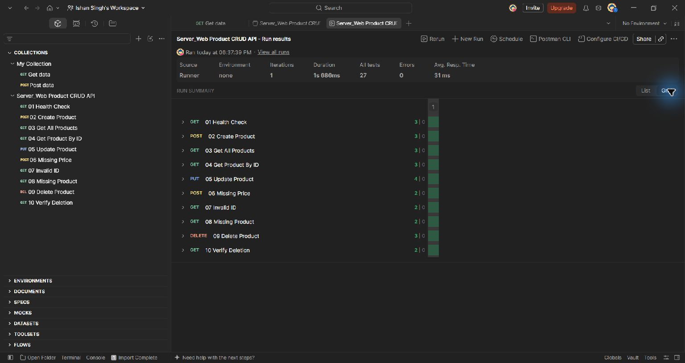

## 1. Health check - 200 OK

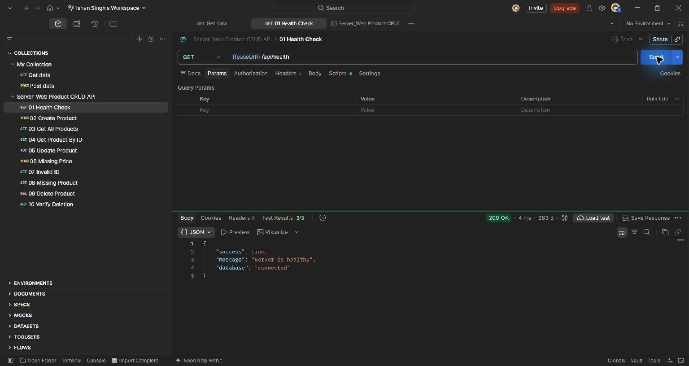

## 2. Create product - 201 Created

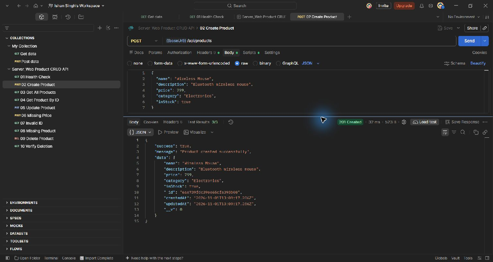

## 3. Get all products - 200 OK

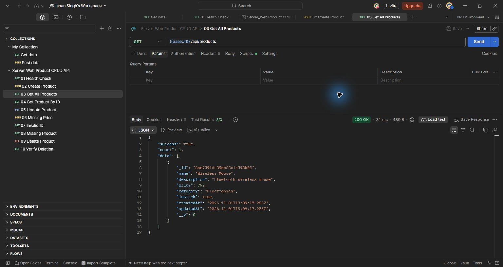

## 4. Get product by ID - 200 OK

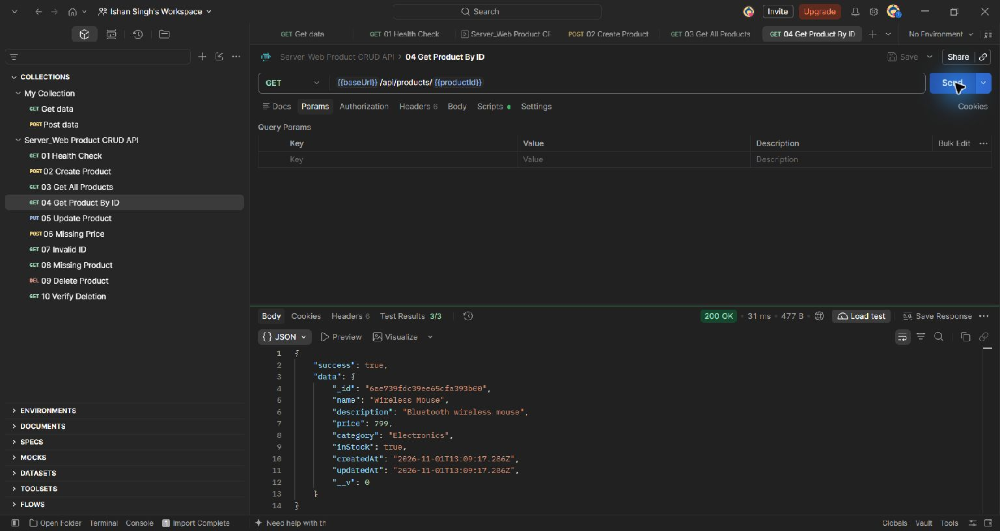

## 5. Update product - 200 OK

The request changes the price from 799 to 699 and inStock from true to false.

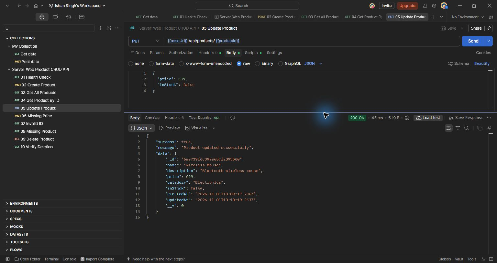

## 6. Missing required price - 400 Bad Request

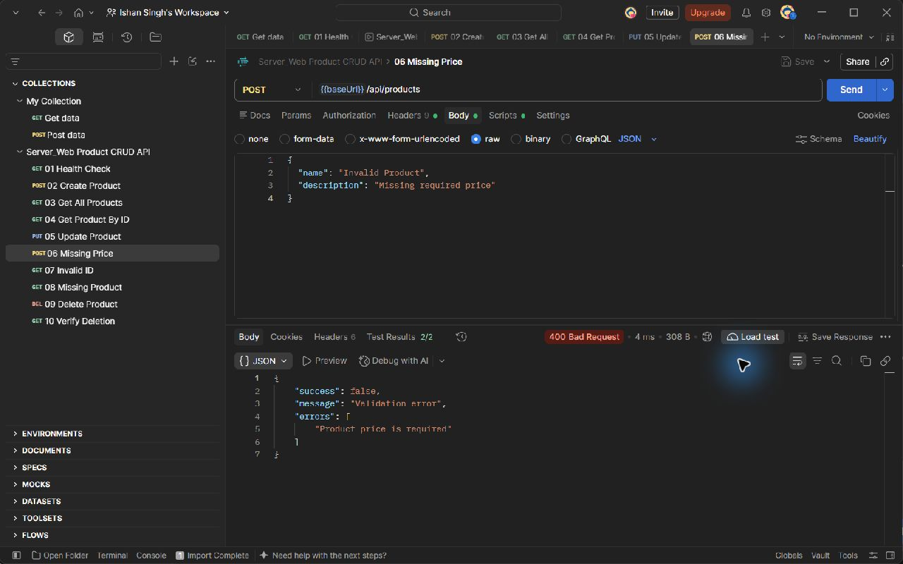

## 7. Invalid product ID - 400 Bad Request

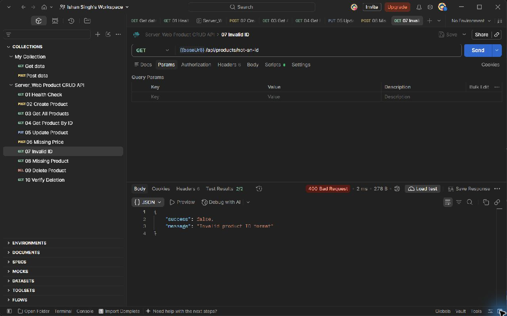

## 8. Nonexistent product - 404 Not Found

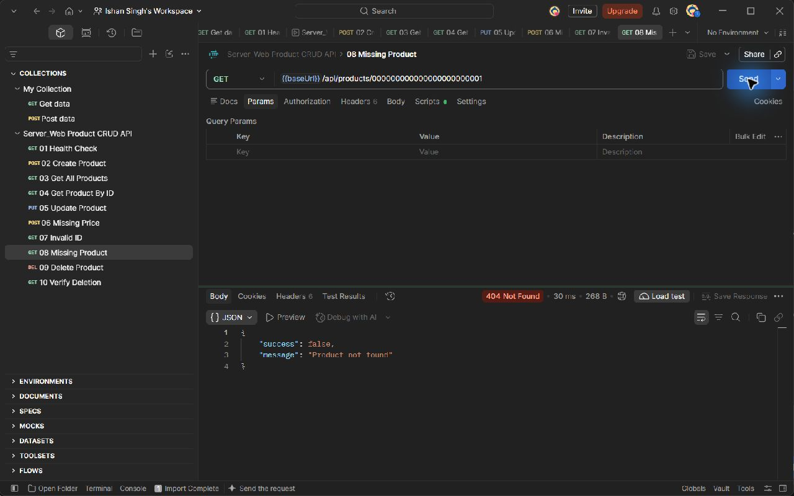

## 9. Delete product - 200 OK

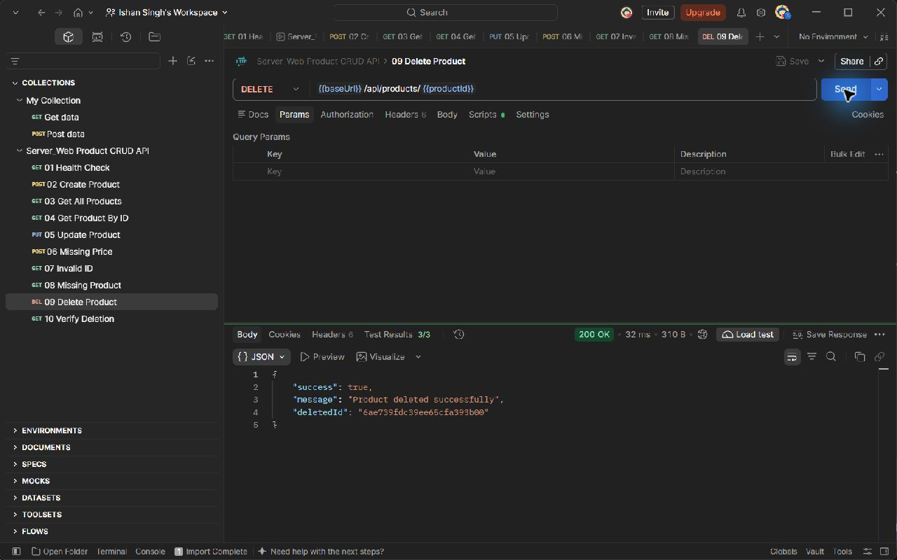

## 10. Confirm deletion - 404 Not Found

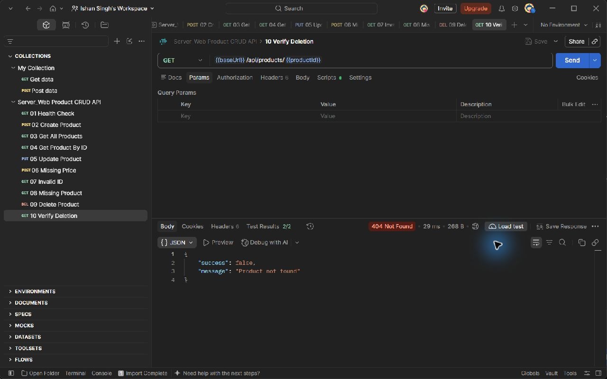

## Remaining database-view evidence

A MongoDB Compass screenshot has not been captured yet. To capture one, run
Create Product again, inspect `product_db.products` in Compass, and take a
screenshot of the document without exposing the connection string or password.
